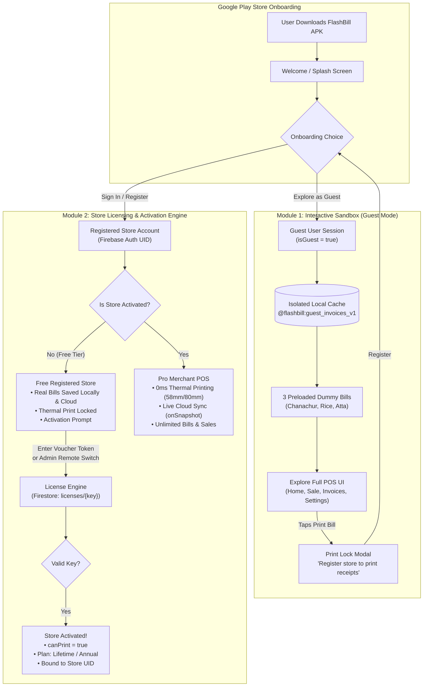

# FlashBill Commercialization Plan: Interactive Sandbox & Store Licensing System

This architectural plan outlines the two-module strategy for publishing FlashBill POS on the Google Play Store with:
1. **Module 1: Interactive Sandbox / Try-Before-You-Buy (Guest Mode)**: Frictionless exploration, isolated local demo storage, sample bills preview, and printer/cloud gating.
2. **Module 2: Client Licensing & Store Activation Engine**: Cloud-verified activation tokens, admin remote toggle, hardware/store binding, and direct monetization.

---

## Architecture Flow



---

## Module 1: Interactive Sandbox / Try-Before-You-Buy (Guest Mode)

This module enables any user downloading FlashBill from Google Play to instantly test the app, experience its speed, draft orders, and preview realistic receipts without being forced to register first.

### 1.1 Guest Onboarding & Auth Gate Extension (`context/AuthContext.tsx` & `components/Auth/AuthScreen.tsx`)
- **"Explore as Guest (Demo Mode)" Action**:
  - Placed prominently below the login/registration forms as an outlined secondary button:  
    `[ 🚀 Skip Login & Explore Demo Mode → ]`
- **Virtual Guest Profile**:
  - When tapped, `AuthContext` generates a virtual session:
    ```typescript
    const GUEST_PROFILE: UserProfile = {
      uid: 'guest_user',
      email: 'demo@flashbill.pos',
      shopName: 'Demo Supermarket',
      ownerName: 'Guest Merchant',
      phone: '9876543210',
      isGuest: true,
      createdAt: new Date().toISOString(),
      lastLoginAt: new Date().toISOString(),
    };
    ```
  - Bypasses the top-level Auth Gate in `App.tsx` immediately without calling Firebase Auth network APIs.
  - Does not persist across explicit logouts; users can switch between Guest and Real Login with 1 tap.

### 1.2 Isolated Local Cache Engine (`services/storageService.ts`)
- **Zero Cross-Contamination**:
  - Real accounts use `@flashbill:invoices_v1`.
  - Guest mode uses an isolated storage key: `@flashbill:guest_demo_invoices_v1`.
- **Pre-seeded Dummy Invoices**:
  - Upon first entering Guest Mode, the app populates `@flashbill:guest_demo_invoices_v1` with 3 diverse sample bills:
    1. *Bill #1*: Grocery & Spices (Chanachur, Potato, Suji, Maida) - ₹5,826.00
    2. *Bill #2*: Daily Essentials (Basmati Rice, Sunflower Oil) - ₹920.00
    3. *Bill #3*: Grains & Pulses (Wheat Atta, Sugar) - ₹559.50
  - The Home metrics strip, Recent Bills card, and Invoices & Receipts tab immediately appear vibrant, populated, and testable.
- **Drafting Bills in Guest Mode**:
  - The guest can open the **Sale** tab, search through all 23 grocery categories, add items, apply discounts, and tap **"Save Bill"**.
  - The bill saves **only** into `@flashbill:guest_demo_invoices_v1`.
  - When the guest later registers a real account, their real account starts with a 100% clean ledger starting at **Invoice #1**.

### 1.3 Guest Visual Indicators & Status Badges (`FlashHeader.tsx` & `AppDrawer.tsx`)
- **Header Status Pill**:
  - Instead of *"Verified Store"*, displays: `[ 🟡 DEMO MODE (PRINTER LOCKED) ]`.
- **Invoices Screen Banner**:
  - A friendly header note:  
    `"Showing 3 Demo Receipts. Register your store to start your official ledger."`
- **Drawer Quick CTA**:
  - A highlighted button at the top of the side navigation drawer:  
    `[ 🔐 Claim Real Store Account ]`.

### 1.4 Feature Boundary Gating (Printer Lock & Cloud Bypass)
- **Thermal Print Gate (`handlePrint`)**:
  - Tapping **"Print"** on any screen checks: `if (user?.isGuest)`.
  - Immediately displays an interactive modal (`GuestPrintModal.tsx`):
    > 🖨️ **Thermal Printing Requires Store Account**  
    > *Connect your 58mm or 80mm Bluetooth printer and print instant thermal receipts by registering your free store account.*  
    > **[ 🚀 Create Free Account ]**  
    > *[ Keep Exploring Demo ]*
- **Cloud Firestore Shield (`services/syncService.ts`)**:
  - All cloud methods (`pushInvoice`, `pullAllInvoices`, `subscribeToInvoices`) start with:
    `if (!userId || userId === 'guest_user') return;`
  - Guarantees that casual Play Store downloads **never touch Cloud Firestore**, saving 100% of your Google Firebase Spark free tier quota.

---

## Module 2: Client Licensing & Store Activation Engine

This module provides the commercial layer: controlling who can print, preventing unauthorized usage, and allowing you to collect payments directly via UPI, cash, or offline packages.

### 2.1 Cloud Firestore License Schema (`config/firebase.ts` & Security Rules)
A dedicated, isolated collection in Cloud Firestore: **`licenses/{licenseKey}`**

```
licenses/{licenseKey} (Document)
  ├── key: "FLASH-8942-X7K1-9920"      (Unique 16-char alphanumeric key)
  ├── plan: "LIFETIME" | "1_YEAR"      (License tier)
  ├── status: "AVAILABLE" | "CLAIMED"   (Voucher state)
  ├── claimedByUid: "F8FDb1r2zsc66..."  (Bound to Merchant UID)
  ├── claimedByEmail: "sahid@..."       (Store Email)
  ├── claimedAt: 1793566986876          (Activation timestamp)
  ├── expiresAt: null | 1825102986876   (Expiration date; null for Lifetime)
  └── maxPrinters: 1                    (Hardware entitlement)
```

#### Security Rule in Firebase Console:
```javascript
match /licenses/{licenseKey} {
  // Only authenticated users can read an unassigned key or their own claimed key
  allow read: if request.auth != null;
  // Users can only claim an AVAILABLE license for their own UID
  allow update: if request.auth != null 
    && resource.data.status == "AVAILABLE"
    && request.resource.data.claimedByUid == request.auth.uid;
}
```

### 2.2 License Management Service (`services/licenseService.ts`)
- `redeemLicense(userId: string, keyInput: string)`:
  1. Formats input (uppercases, trims hyphens).
  2. Reads `licenses/{key}` from Firestore.
  3. Checks `status === 'AVAILABLE'`.
  4. Atomically marks `status = 'CLAIMED'`, `claimedByUid = userId`, `claimedAt = Date.now()`.
  5. Updates `users/{userId}` profile: `isActivated = true`, `plan = license.plan`.
  6. Saves local activation cache to `@flashbill:store_license_v1`.
- `checkStoreLicense(userId: string)`:
  - Listens via `onSnapshot` to `users/{userId}` for real-time license updates.
  - Automatically handles expiration dates for annual subscriptions.

### 2.3 Store Activation Modal (`components/License/ActivationModal.tsx`)
A branded, high-trust activation modal accessible from:
1. Attempting to print when unactivated.
2. Clicking **"Activate Store"** in the Account Sheet or Drawer.
- **Fields & Elements**:
  - Alphanumeric voucher input with auto-formatting (`XXXX-XXXX-XXXX-XXXX`).
  - **"Activate Now"** button with loading spinner.
  - **"Contact Sales / Get License"** button: Opens WhatsApp directly to your number with a pre-filled message:
    > *"Hello FlashBill Admin, I want to purchase an activation key for my store: [Store Name] ([User Email])"*

### 2.4 Dual Activation Modes: Voucher Token vs. Admin Remote Switch

You have two flexible ways to activate a customer:

| Method | When to Use | How It Works |
| :--- | :--- | :--- |
| **Method A: Voucher Token** | Selling hardware packages or printer bundles. | You generate a key in Firebase Console and send it to the client. The client enters it in the app. |
| **Method B: Admin Remote Switch** | Direct B2B sales via WhatsApp/UPI. | Client messages you. You open Firebase Console on your phone, find `users/{uid}`, and set `canPrint: true`. Their app unlocks in **0.5 seconds** automatically! |

### 2.5 Hardware & Account Binding Protection
- Prevents a merchant from sharing one token with other shopkeepers.
- Once a token is claimed in Firestore, its status is permanently set to `"CLAIMED"` and tied to that store's `claimedByUid`.
- If another user tries to type the same key, Firestore rejects the redemption with: *"License voucher already claimed by another store."*

---

## Access & Capabilities Matrix

| Feature | Guest User (Demo) | Free Registered Store | Activated Pro Store |
| :--- | :---: | :---: | :---: |
| **Explore App & UI** | ✅ Yes | ✅ Yes | ✅ Yes |
| **Search 23 Grocery Categories** | ✅ Yes | ✅ Yes | ✅ Yes |
| **Draft & Calculate Bills** | ✅ Yes | ✅ Yes | ✅ Yes |
| **58mm / 80mm Layout Switcher** | ✅ Yes | ✅ Yes | ✅ Yes |
| **View Sample Bills** | ✅ (3 Preloaded) | ❌ (Clean Ledger) | ❌ (Clean Ledger) |
| **Save Real Bills to Storage** | ❌ (Guest Sandbox) | ✅ Yes | ✅ Yes |
| **Google Cloud Firestore Sync** | ❌ Blocked (0 Cost) | ✅ Yes | ✅ Yes |
| **Multi-Device Restore** | ❌ No | ✅ Yes | ✅ Yes |
| **Thermal Bluetooth Printing** | ❌ Locked (Modal) | ❌ Locked (Voucher) | ✅ **Full 0ms Printing** |
| **Store Name on Receipt Header** | ❌ Demo Header | ✅ Custom Shop Name | ✅ Custom Shop Name |

---

## Implementation Roadmap

| Phase | Module | Scope | Status |
| :--- | :--- | :--- | :---: |
| **Phase 1** | Module 1 (Sandbox) | Add "Explore as Guest" button to `AuthScreen.tsx` and virtual `isGuest` session in `AuthContext.tsx`. | 📋 Planned |
| **Phase 2** | Module 1 (Sandbox) | Implement isolated `@flashbill:guest_demo_invoices_v1` in `storageService.ts` with 3 preloaded bills. | 📋 Planned |
| **Phase 3** | Module 1 (Sandbox) | Add Print Lock modal and Cloud Sync guard for guest users. | 📋 Planned |
| **Phase 4** | Module 2 (Licensing) | Create `licenses` schema in Firestore and build `licenseService.ts` for redemption. | 📋 Planned |
| **Phase 5** | Module 2 (Licensing) | Build `ActivationModal.tsx` with voucher input and WhatsApp sales trigger. | 📋 Planned |
| **Phase 6** | Module 2 (Licensing) | Wire thermal printer dispatch to verify activation status before sending bytes to Bluetooth. | 📋 Planned |

