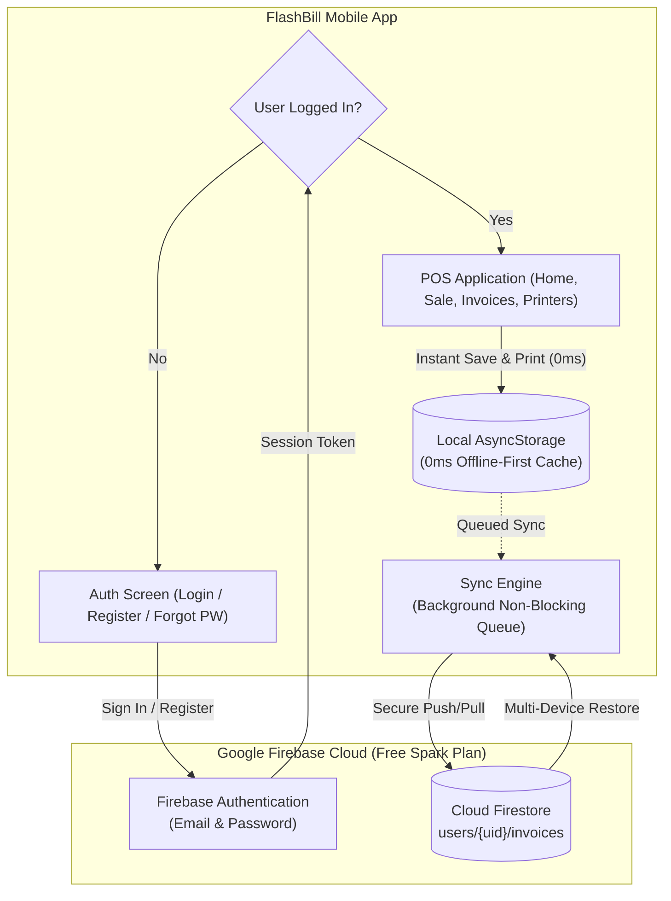

# FlashBill Firebase (Firestore + Auth) Integration Plan

This plan outlines the two-module architecture for enabling **free-tier, multi-device cloud synchronization** with **bank-grade security** and **uninterrupted 0ms retail billing speed**.

---

## Architecture Flow



---

## Module 1: Pre-requisites UI & Components

This module builds the user-facing account management interface, styled with FlashBill's retail design system (light/dark mode dynamic support).

### 1.1 Auth Gateway & State (`context/AuthContext.tsx`)
- Manages authentication state: `user`, `loading`, `signIn`, `signUp`, `signOut`, `resetPassword`.
- Uses `getReactNativePersistence(AsyncStorage)` so the client **stays logged in forever** unless they explicitly click "Log Out".
- Controls top-level gating in `App.tsx`:
  - `loading === true`: Display custom Splash / Loading indicator.
  - `user === null`: Mounts `<AuthScreen />`.
  - `user !== null`: Mounts full POS experience.

### 1.2 Authentication Screen (`components/Auth/AuthScreen.tsx`)
A unified, branded screen with FlashBill logo and toggleable tabs:
1. **Login Tab (`LoginView.tsx`)**:
   - Email and Password fields with clear icons and visibility toggle.
   - "Remember Me" preference.
   - "Forgot Password?" trigger.
   - Primary **"Login to Store"** CTA with loading spinner.
2. **Register Tab (`RegisterView.tsx`)**:
   - **Shop / Business Name** (e.g., *"Aftab Supermarket"*) — automatically becomes the receipt header title!
   - **Owner Name & Phone Number** — for receipts and store profile.
   - **Email & Password** (with 6+ char validation).
   - Primary **"Create Store Account"** CTA.
3. **Forgot Password Modal (`ForgotPasswordModal.tsx`)**:
   - 1-tap modal to enter email and trigger password reset email via Firebase.

### 1.3 Cloud Sync & Store Header Indicators (`components/HomeScreen/FlashHeader.tsx`)
- **Cloud Sync Status Badge**:
  - 🟢 **Synced**: All receipts are safely backed up to Google Cloud.
  - 🟡 **Syncing...**: Active background sync in progress.
  - ⚪ **Offline**: Internet disconnected; bills queued locally in `AsyncStorage`.
- **Store Profile Avatar**: Displays store initials; tapping opens the **Account Sheet**.

### 1.4 Account Management Modal (`components/AccountModal.tsx`)
- Displays: Store Name, Owner Email, Active Plan (*"Free Forever (Spark)"*), and Total Synced Receipts.
- **"Force Sync Now"** button (manually pulls updates from cloud).
- **"Log Out"** button with confirmation modal (clears sensitive user data safely).

---

## Module 2: Backend (Firebase SDK & Firestore Engine)

This module configures the cloud database, security rules, and non-blocking sync pipeline.

### 2.1 Firebase Setup & Configuration (`config/firebase.ts`)
- Install standard Expo-compatible dependencies:
  - `firebase@^10.x`
- Initialize Firebase App, Auth (with AsyncStorage persistence), and Firestore.

### 2.2 Firestore Database Schema
Multi-tenant security model where each store owner has their own isolated document tree:

```
users/{userId}
  ├── profile (document)
  │     ├── shopName: "Aftab Supermarket"
  │     ├── ownerName: "Mohd Adil"
  │     ├── phone: "9876543210"
  │     ├── address: "Shop #4, Market Road"
  │     ├── gstin: "07AAAAA0000A1Z5"
  │     └── nextInvoiceNo: 105
  │
  └── invoices (collection)
        └── {invoiceNo} (document)
              ├── invoiceNo: "1"
              ├── customerName: "Rahul Sharma"
              ├── customerPhone: "9876543210"
              ├── date: "31/10/2026"
              ├── time: "04:30 PM"
              ├── status: "PAID"
              ├── subtotal: "1240.00"
              ├── totalDiscount: "140.00"
              ├── grandTotal: "1100.00"
              ├── items: [...]
              └── updatedAt: 1730400000000
```

### 2.3 Bank-Grade Firestore Security Rules
Enforced in the Firebase Console:
```javascript
rules_version = '2';
service cloud.firestore {
  match /databases/{database}/documents {
    match /users/{userId}/{document=**} {
      allow read, write: if request.auth != null && request.auth.uid == userId;
    }
  }
}
```
*Guarantees zero cross-shop leakage: No shopkeeper can ever view or modify another store's invoices.*

### 2.4 High-Performance Dual-Sync Engine (`services/syncService.ts`)
1. **0ms Billing Latency (Local First)**:
   - When the user presses **"Save"** or **"Save & Print"**, the invoice is saved instantly to **`AsyncStorage`** and sent to the Bluetooth printer immediately.
   - It **does not wait** for the internet or Firebase.
2. **Background Push**:
   - `syncService` queues and uploads the invoice to Firestore in the background.
3. **Cross-Device Pull on Login**:
   - When the client installs FlashBill on a new phone and logs in, `syncService.pullAllInvoices(userId)` downloads their full invoice history into `AsyncStorage`.
   - The shopkeeper can immediately reprint or search past bills from their new phone.

---

## Implementation Roadmap

| Step | Scope | Details | Status |
| :--- | :--- | :--- | :---: |
| **Phase 1** | Dependencies & Config | Installed `firebase`, created `config/firebase.ts` with real keys. | ✅ **Complete** |
| **Phase 2** | Module 1 (Auth UI) | Built `AuthContext`, `LoginView`, `RegisterView`, `ForgotPasswordModal`, and `AccountModal`. | ✅ **Complete** |
| **Phase 3** | App Gating | Wired `App.tsx` with Auth Gate and Drawer navigation. | ✅ **Complete** |
| **Phase 4** | Module 2 (Sync Engine) | Implemented `syncService.ts` for non-blocking push/pull & multi-device restore. | ✅ **Complete** |
| **Phase 5** | Verification | Strict TypeScript compilation verified (0 errors). | ✅ **Complete** |
